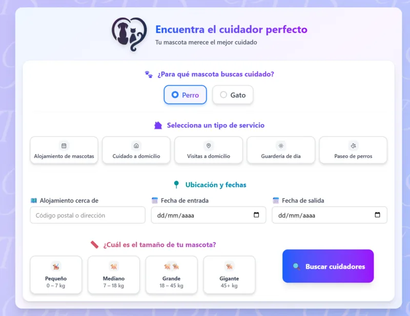

# PlataformaPets

## TL;DR (English)

Full-stack pet-sitting marketplace: pet owners search and book independent
sitters or boarding companies by geolocation, with real-time chat and
reviews. Final-degree project (Proyecto final de DAW, 2025). Laravel 12 +
Sanctum + PostgreSQL + Redis on the backend, React 19 + Vite + TailwindCSS
on the frontend, Docker Compose for local orchestration. It is a graded MVP,
not a production-hardened app — see "Estado y seguridad" below.

Plataforma web para conectar dueños de mascotas con cuidadores particulares y empresas de alojamiento animal. Permite buscar, reservar y valorar servicios de cuidado de mascotas con chat en tiempo real integrado.

Proyecto final de DAW (2025).



---

## Stack tecnológico

| Capa | Tecnología |
|------|-----------|
| Frontend | React 19, Vite, TailwindCSS v4, TanStack Query, React Router v7 |
| UI | shadcn/ui (Radix UI), Lucide React |
| Formularios | React Hook Form + Zod |
| Backend | Laravel 12, PHP 8.2 |
| Autenticación | Laravel Sanctum (SPA) |
| Base de datos | PostgreSQL 15 |
| Caché / Colas | Redis |
| WebSockets | Laravel Echo Server + Socket.io |
| Colas | Laravel Queue Worker |
| Infraestructura | Docker Compose |

---

## Funcionalidades principales

- **Búsqueda de cuidadores** — Listado filtrable de cuidadores particulares y empresas con mapa de Google Maps
- **Perfiles de host** — Ficha completa con servicios, precios, valoraciones y galería
- **Gestión de mascotas** — Alta y administración de mascotas por usuario
- **Reservas** — Solicitud, aceptación y cancelación de estancias; notificaciones automáticas por email y en app
- **Valoraciones** — Sistema de reseñas post-reserva
- **Chat en tiempo real** — Mensajería privada bidireccional entre usuarios vía WebSockets
- **Notificaciones en tiempo real** — Alertas instantáneas de estado de reservas
- **Registro dual** — Flujo diferenciado para cuidadores particulares y empresas

---

## Arquitectura

```
┌─────────────────────────────────────────────────────┐
│                    Docker Compose                   │
│                                                     │
│  ┌──────────┐   ┌──────────┐   ┌─────────────────┐ │
│  │ frontend │   │  nginx   │   │   echo-server   │ │
│  │  :80     │   │  :8000   │   │     :6001       │ │
│  └────┬─────┘   └────┬─────┘   └────────┬────────┘ │
│       │              │                  │           │
│       └──────────────┤                  │           │
│                      ▼                  │           │
│               ┌──────────┐             │           │
│               │ laravel  │◄────────────┘           │
│               │   app    │                         │
│               └────┬─────┘                         │
│                    │                               │
│          ┌─────────┴─────────┐                     │
│          ▼                   ▼                     │
│    ┌──────────┐       ┌──────────┐                 │
│    │ postgres │       │  redis   │                 │
│    └──────────┘       └────┬─────┘                 │
│                            │                       │
│                     ┌──────▼──────┐                │
│                     │queue-worker │                │
│                     └─────────────┘                │
└─────────────────────────────────────────────────────┘
```

El frontend (React) se comunica con el backend (Laravel) a través de la API REST bajo Sanctum. Los WebSockets van directamente al echo-server, que usa Redis como broker. El queue-worker procesa las notificaciones en background.

---

## Requisitos previos

- [Docker](https://docs.docker.com/get-docker/) y Docker Compose
- Git

---

## Instalación y puesta en marcha

### 1. Clonar el repositorio

```bash
git clone <url-del-repo>
cd PlataformaPets
```

### 2. Configurar variables de entorno del backend

```bash
cp backend/.env.example backend/.env
```

Edita `backend/.env` con tus valores. Los mínimos necesarios para desarrollo local:

```env
APP_KEY=          # se genera en el paso 4
DB_CONNECTION=pgsql
DB_HOST=db
DB_PORT=5432
DB_DATABASE=pet_hosting
DB_USERNAME=postgres
DB_PASSWORD=postgres

REDIS_HOST=redis
REDIS_PORT=6379

BROADCAST_DRIVER=redis
QUEUE_CONNECTION=redis

SANCTUM_STATEFUL_DOMAINS=localhost,localhost:80
SESSION_DOMAIN=localhost
```

### 3. Configurar variables de entorno del frontend

```bash
cp frontend/.env.example frontend/.env
```

```env
VITE_API_URL=http://localhost:8000
VITE_ECHO_HOST=http://localhost:6001
VITE_GOOGLE_MAPS_KEY=       # API key de Google Maps (Maps JS + Places), restringida por referer/API en Google Cloud Console
```

### 4. Levantar los contenedores

```bash
docker compose up -d --build
```

### 5. Inicializar el backend

```bash
# Generar clave de aplicación
docker exec laravel-app php artisan key:generate

# Ejecutar migraciones y seeders
docker exec laravel-app php artisan migrate --seed
```

### 6. Acceder a la aplicación

| Servicio | URL |
|----------|-----|
| Aplicación web | http://localhost |
| API Laravel | http://localhost:8000 |
| Echo Server (WebSockets) | ws://localhost:6001 |

---

## Comandos útiles

```bash
# Ver logs de todos los servicios
docker compose logs -f

# Ver logs de un servicio concreto
docker compose logs -f app
docker compose logs -f echo-server
docker compose logs -f queue-worker

# Reiniciar un servicio
docker compose restart app

# Ejecutar comandos Artisan
docker exec laravel-app php artisan <comando>

# Acceder al contenedor del backend
docker exec -it laravel-app bash

# Resetear la base de datos
docker exec laravel-app php artisan migrate:fresh --seed

# Parar todos los contenedores
docker compose down
```

---

## Estructura del proyecto

```
PlataformaPets/
├── backend/                  # API Laravel 12
│   ├── app/
│   │   ├── Http/
│   │   │   ├── Controllers/  # AuthController, ChatController, ReservationController...
│   │   │   ├── Requests/     # Validación de formularios
│   │   │   └── Resources/    # Transformadores de respuesta API
│   │   ├── Models/           # User, Host, Pet, Reservation, Chat, Message, Review...
│   │   ├── Events/           # MessageSent (WebSocket)
│   │   ├── Notifications/    # ReservaSolicitada, ReservaActualizada, ReservaCancelada
│   │   └── Policies/         # Autorización por recurso
│   ├── routes/
│   │   ├── api.php           # Rutas REST
│   │   └── channels.php      # Canales de broadcasting
│   └── Dockerfile
│
├── frontend/                 # SPA React 19
│   ├── src/
│   │   ├── pages/            # Inicio, PerfilCuidador, Pets, MisReservas, Chat...
│   │   ├── components/       # Componentes reutilizables + chat/ + host-profile/ + ui/
│   │   ├── context/          # AuthContext, ChatContext, ToastContext, ModalContext
│   │   ├── hooks/            # useHosts, useReservations, useMessages, useNotifications...
│   │   ├── services/         # Llamadas a la API agrupadas por recurso
│   │   └── lib/              # axios, echo (WebSocket), queryClient
│   └── Dockerfile
│
├── nginx/
│   └── default.conf          # Configuración del proxy inverso
└── docker-compose.yml
```

---

## Estado y seguridad

Este es un MVP académico (proyecto final de DAW) con funcionalidad end-to-end
(auth, mascotas, búsqueda geolocalizada, reservas, chat en tiempo real,
reseñas, notificaciones), pero **no está listo para producción tal cual**.
Se ha realizado una auditoría interna de arquitectura y seguridad; el backlog
de saneamiento (autenticación, límites de peticiones, CORS, validaciones,
cobertura de tests, etc.) se está trasladando a issues de este repositorio
para abordarlo de forma incremental. Si vas a desplegarlo o reutilizar
código de aquí, revisa los issues abiertos antes.

## Licencia

MIT — ver [LICENSE](LICENSE)
